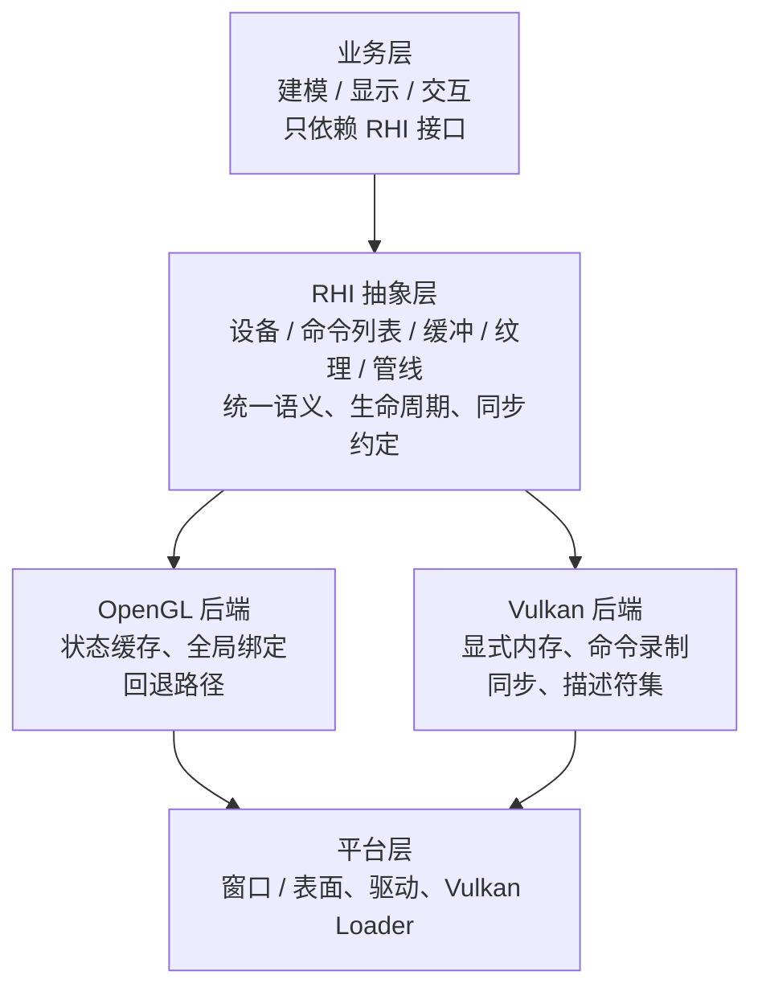

# 架构设计

这份讲：系统分几层、边界在哪、为什么这么设计、怎么从 OpenGL 迁到 RHI。

## 背景与目标

- 背景：现引擎基于 OpenGL，要新增 Vulkan 后端，同时保留 OpenGL 当回退。业务代码和 OpenGL 封装深度耦合，要靠 RHI 抽象层解开。
- 目标：一套业务代码驱动两个后端，启动时选，失败能回退；业务层不碰任何后端 API，只依赖 RHI 抽象接口。

## 非目标（本期不做）

- 不一次迁所有渲染特性，先覆盖视口渲染、实体显示、线框/着色模式切换这些核心路径。
- 不替换窗口系统，沿用现有窗口/表面方案。
- 不引入 ANGLE 等翻译层当主路径。

## 关键约束

- 目标平台：Linux 为主（信创环境待确认），Windows、macOS 保留。
- Vulkan 版本：部分系统预装版本偏低（参考里说 1.2 vs 要求 1.3，待核实），启动时探测，不够就回退 GL。
- 团队 OpenGL 经验足，Vulkan 是新增技术栈。

## 分层

依赖方向严格单向：业务 → RHI → 后端 → 平台，不能反向。

### 各层职责

| 层 | 干什么 | 不干什么 |
|---|---|---|
| 业务层 | 建模、显示、交互 | 不直接调 GL/VK，不持有后端句柄 |
| RHI 抽象层 | 统一接口、资源生命周期、同步约定 | 不含业务逻辑，不暴露后端类型 |
| OpenGL 后端 | 实现 RHI，维护 GL 状态，当回退 | 不向上泄漏 GL 全局状态 |
| Vulkan 后端 | 实现 RHI，显式管理内存/命令/同步 | 不向上泄漏 VK 细节 |
| 平台层 | 窗口/表面、驱动探测 | 不参与渲染逻辑 |

## 后端切换与回退

- 切换：环境变量 `RHI_BACKEND`（优先级最高），或宿主写 `backend.cfg`（0=GL / 1=VK，重启生效）。
- 回退：Vulkan 初始化失败（驱动不支持、版本不够）自动回退 OpenGL，记日志说明原因。
- 版本探测：启动时探测 Vulkan 版本和设备特性，低于最低要求就拒绝用 Vulkan。

## 从 OpenGL 迁到 RHI：已完成，原则沉淀

迁移已收尾（2026-11-25）：业务层（render/）只剩一条 RHI 代码路径，
`gl*` 直调清零，遗留帧级 Pass 与双路径切换开关全部删除。沉淀出的原则：

- **差异收进后端**：GL 的 sRGB 写编码、负高度 viewport、纯深度 Pass 的
  Reversed-Z 都在 GLCommandList 的 Pass 边界处理，业务层无感。
- **中性接口补缺口**：业务确实需要的后端差异点（如宽线的视口像素尺寸、
  纹理采样器名）以中性接口进契约（`viewportSize` / `bindTexture(name)`），
  不开后端判断的口子。
- **验证手段**：门禁（tools/rhi_gate.sh）+ 整帧 PPM 逐像素对比
  （见 docs/6），场景区差异 <1% 视为一致。
4. 逐模块迁移：业务侧按模块迁到 RHI，GL 下行为不变，保留回退。
5. 汇合验证：VK 接入真实场景，逐步扩大范围。

## 风险与应对

| 风险 | 应对 |
|---|---|
| 目标 Linux 的 Vulkan 版本偏低 | 启动探测 + 自动回退 GL，或降级特性需求 |
| 国产显卡 Vulkan 驱动不成熟 | 建驱动兼容性矩阵，逐卡验证 |
| 业务代码和 OpenGL 耦合深 | 先盘点分类，Demo 验证接口，保留 GL 回退 |
| 管线组合爆炸 | 管线缓存 + 按需预创建 |
| 同步错误崩溃 | 验证层常开 + 时序图对照 + 回归清单 |

## 待确认（问宿主）

- 目标平台是不是银河麒麟等信创 Linux？（待确认）
- Vulkan 最低版本要求是多少？（参考里说部分系统预装 1.2、引擎要 1.3，待核实）
- 资源生命周期最终选 RAII 还是引用计数？（已定：句柄 + 延迟销毁，见 2 号文档）
- PSO 缓存上限策略？（待定）
