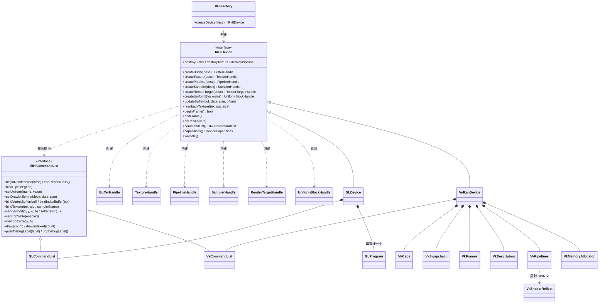
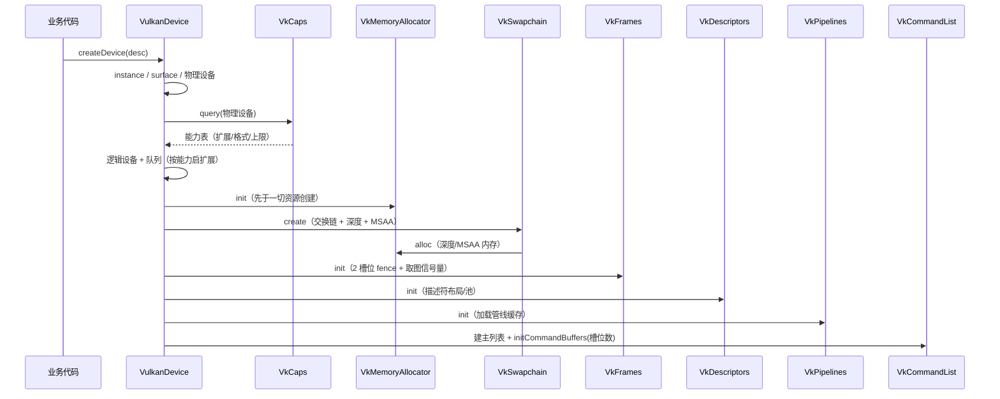
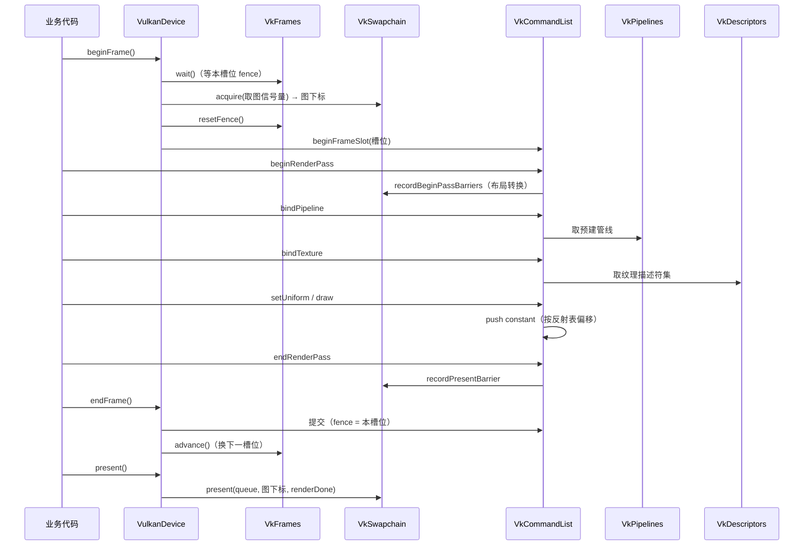
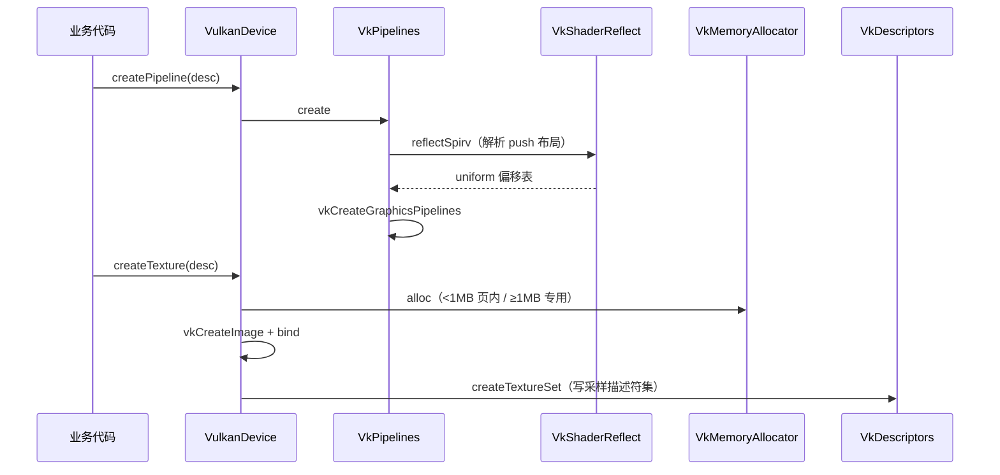
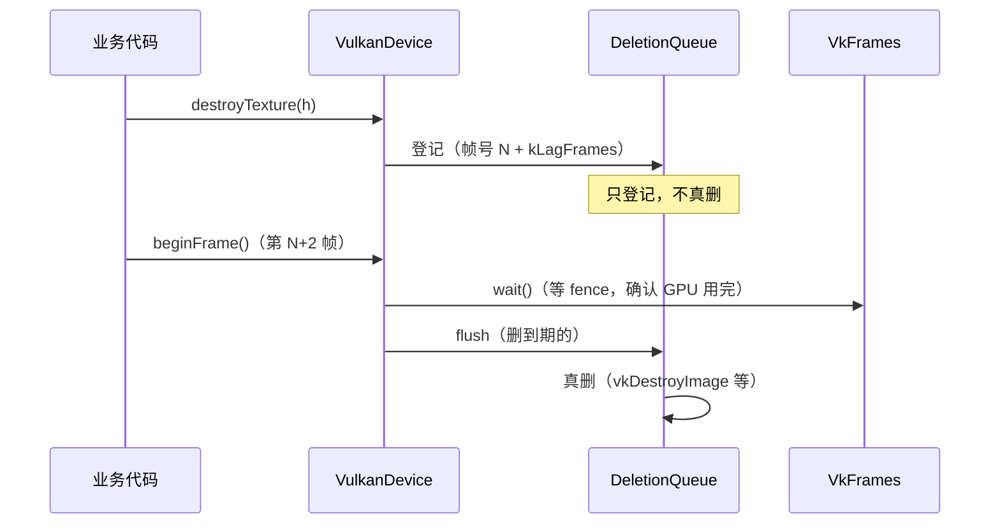
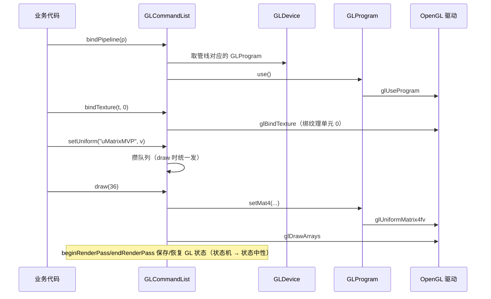
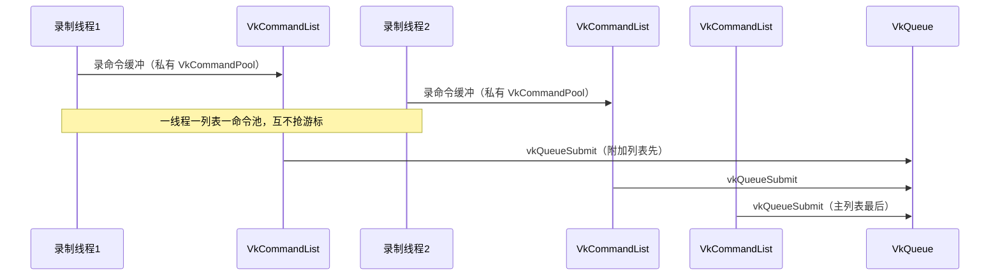

# 类设计与时序图

这份讲：代码怎么组织、运行起来怎么协作。图用 Mermaid，编辑器里自动渲染成图。

## 核心类图

Vulkan 后端内部怎么分（V3-3 之后）：

| 内部类 | 管什么 | 文件 |
|---|---|---|
| VulkanDevice | 对外门面：资源句柄表、帧循环、事件；初始化/资源/纹理拆成独立 .cpp | `vk/VkDevice.*` + `VkDeviceInit/Resources/Texture.cpp` |
| VkCaps | 物理设备能力探测一次：扩展/格式/上限，供各处按能力选路径 | `vk/VkCaps.*` |
| VkSwapchain | 交换链、每张图视图/布局、深度 + MSAA 附件、逐图 render-done 信号量 | `vk/VkSwapchain.*` |
| VkFrames | 帧在飞：每槽位 fence + 取图信号量，轮转（命令缓冲归 VkCommandList） | `vk/VkFrames.*` |
| VkDescriptors | 描述符布局/池、纹理采样集、全局管线布局、帧 uniform 集 | `vk/VkDescriptors.*` |
| VkPipelines | 着色器加载、管线状态烘焙、管线缓存（反射交给 VkShaderReflect） | `vk/VkPipelines.*` |
| VkShaderReflect | SPIR-V 最小反射：解析 push constant / UBO 成员偏移（setUniform 按名定位） | `vk/VkShaderReflect.*` |
| VkMemoryAllocator | 显存子分配：8MB 页内 first-fit + ≥1MB 专用 | `vk/VkMemoryAllocator.*` |
| VkCommandList | 命令录制：每条列表自有命令池 + uniform 环（一线程一列表） | `vk/VkCommandList.*` |

拆的原则：一个类只管一件生命周期一致的事。交换链随窗口重建，描述符跟着纹理走，管线缓存跨帧存活——三者生命周期不同，混在一个类里容易互相牵连。

为什么 GL 后端只有 3 个类、Vulkan 要拆 9 个模块，见 docs/5「后端实现规模差异」。

V3-6 多命令列表：一条命令列表自己按帧槽位持有一组命令缓冲（两帧在飞时不能共用），并持有私有命令池与 uniform 环——多线程录制的前提是「一线程一列表一命令池」。设备每帧把所有列表重置并开始录制；提交顺序是「用过的附加列表（按创建顺序）→ 主列表」，主列表负责呈现前的布局转换。OpenGL 没有延迟提交，`createCommandList()` 返回主列表本身，命令按调用顺序立即执行——最终画面一致，只是没有并行收益。

说明：

- 两个接口：IRHIDevice（设备）、IRHICommandList（命令列表）。
- 每个接口两个实现：GL 的（GLDevice、GLCommandList），Vulkan 的（VulkanDevice、VkCommandList）。
- RHIFactory 是工厂，按后端创建设备；命令列表由设备每帧提供。
- 资源（缓冲、纹理、管线、采样器、离屏目标、数据块）是**句柄**，不是对象类。后端内部的数据结构（如 VkBufferRes、GLTexture）不对外暴露。

## Vulkan 后端九模块怎么配合

三张图看配合：初始化（谁先建谁后建）、一帧渲染（谁调谁）、资源创建（反射/内存/描述符分工）。

### 初始化（设备创建，一次）

### 一帧渲染

### 资源创建

## Vulkan 后端绑定层的实际做法（V3-2 已落地）

- 着色器约定：`set=0` 是绘制数据（每帧一块环，动态偏移），`set=1..4` 是四个纹理槽。
- 一张纹理创建时写好自己的描述符集，绘制时直接绑；同一张纹理反复用，不用重写。
- 绘制数据（灯光/材质/相机等）逐次追加进 1MB 帧内环，每帧开头归零。
- 绘制期只发 `vkCmdBindDescriptorSets`（一次绑 5 个 set），不再逐 draw 更新描述符。

## 业务层（render/）核心类

去后端化后业务层只有一条 RHI 路径，类职责如下：

| 类 | 管什么 | 文件 |
|---|---|---|
| RenderSystem | 门面单例：设备所有权、统一帧流程 `renderFrame()`、拾取/阴影/回读验证设施、输入事件 | `RenderSystem.*` |
| Scene | 对象容器：绘制列表（透明排序 + 视锥剔除）、多视口相机、光空间矩阵 | `scene.*` |
| BaseDraw | 可绘制对象基类：对象 ID（原子分配）、光照/透明度开关；构造纯 CPU，GPU 资源子类经 RHI 惰性创建 | `BaseDraw.h` |
| Model | Assimp 解析（含后台预解析缓存，E5）+ 实例矩阵 + AABB；绘制委托 MeshPass | `model/model.*` |
| MeshPass | 网格级绘制策略：RHI 资源惰性创建、着色器选型（贴图/纯色）、blend/线框管线变体、LOD、阴影/拾取绘制 | `model/mesh_pass.*` |
| Line / Sky / CText | 宽线展开 / 天空盒 / SDF 文字，全部只走 RHI | `object/` |
| TextureMng | 磁盘图片解码缓存（纯 CPU；GPU 纹理由绘制对象经 RHI 创建） | `image.*` |
| FontManager | FreeType 加载 + SDF 图集构建（纯 CPU） | `FontManager.*` |

## 资源延迟销毁

创建资源见上面的「资源创建」时序图；这里讲销毁为什么不能立刻做。

关键点：`destroy` 不立刻删，因为 GPU 可能还在用这一帧的数据。用「句柄 + 延迟销毁」，不用引用计数或智能指针。

## GL 后端怎么翻译（翻译器）

Vulkan 后端的调用时序见上面的「九模块怎么配合」，这里补 GL 后端：同一条 RHI 调用，`GLCommandList` 怎么翻译成 OpenGL。GL 是「翻译器」——没有命令池、没有提交，状态由驱动隐式管理。

## 多线程录制（V3-14 已落地）

前提「一线程一列表一命令池」已实现：每条附加命令列表自带私有命令池与
uniform 环（`RHI_VK_MULTILIST=2` 自检）；OpenGL 退化为立即执行，同一调用
序列最终画面一致，只是没有并行收益。业务侧拆 Pass 后即可按 Pass 并行录制。

## 维护约定

- 类图只维护核心骨架，细节靠代码注释。
- 时序图只画关键流程，不追求覆盖所有调用。
- 图用 Mermaid 写，跟代码一起版本管理。
