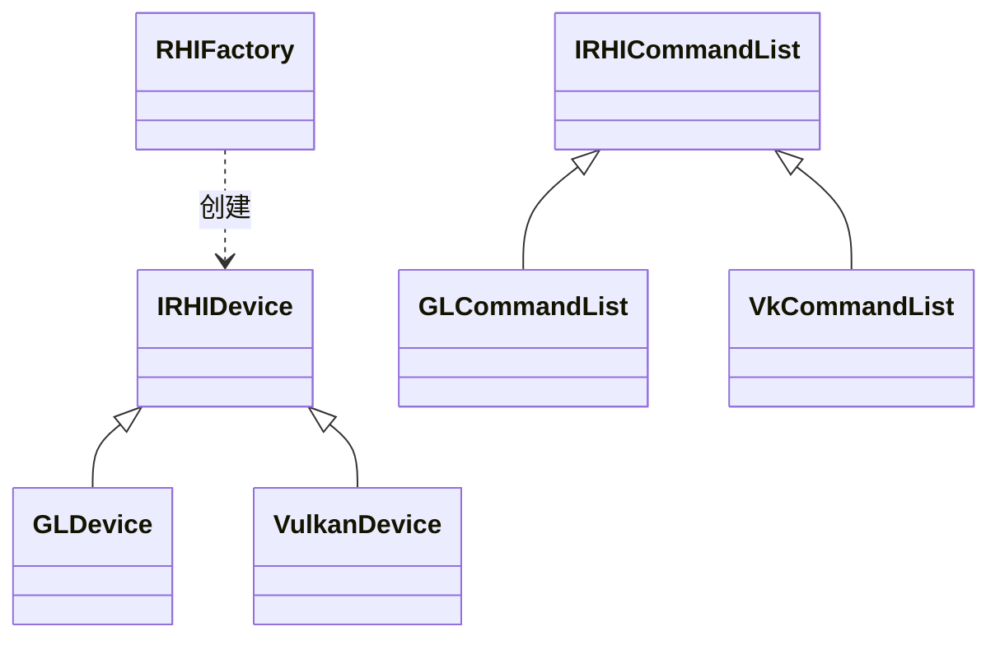
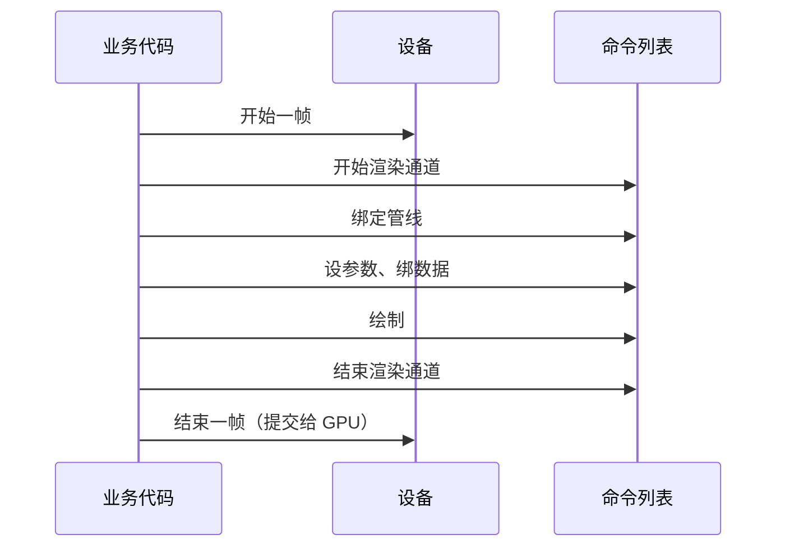
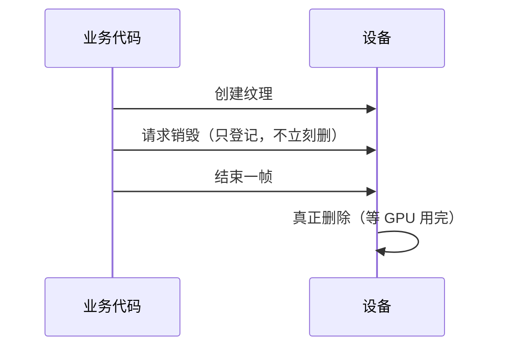

# 类设计与时序图

这份讲：代码怎么组织、运行起来怎么协作。图用 Mermaid 画，编辑器里会自动渲染成图。

## 核心类

说明：

- 两个接口：IRHIDevice（设备）、IRHICommandList（命令列表）。
- 每个接口两个实现：OpenGL 的（GLDevice、GLCommandList），Vulkan 的（VulkanDevice、VkCommandList）。
- RHIFactory 是工厂，按后端创建对应的设备。
- 业务代码只跟接口打交道，不直接碰后端类。

## 资源怎么表示

资源（缓冲、纹理、管线、采样器、离屏目标、数据块）一律用「句柄」表示。
句柄里是 id 和 gen 两个数字；销毁后句柄失效，再用会报错。不导出对象类。

## 一次绘制怎么协作

## 资源从创建到销毁

## 资源生命周期

每个资源经历四个阶段：

创建 → 使用 → 登记销毁 → 帧末真正销毁

关键点：

- 不立刻销毁，因为 GPU 可能还在用这一帧的数据。
- 不用引用计数或智能指针，用「句柄 + 延迟销毁」，简单、可控、好查错。
