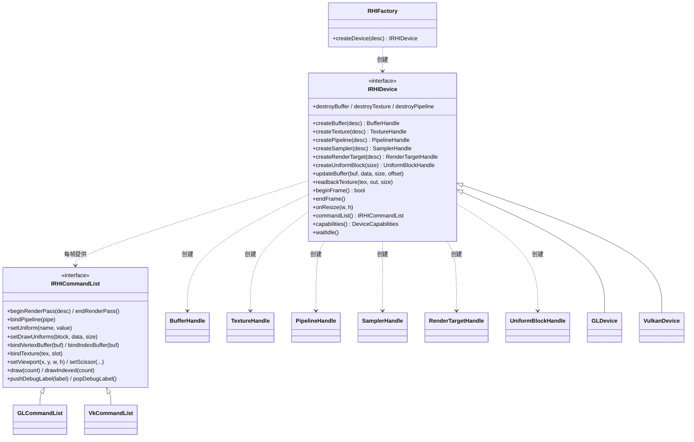
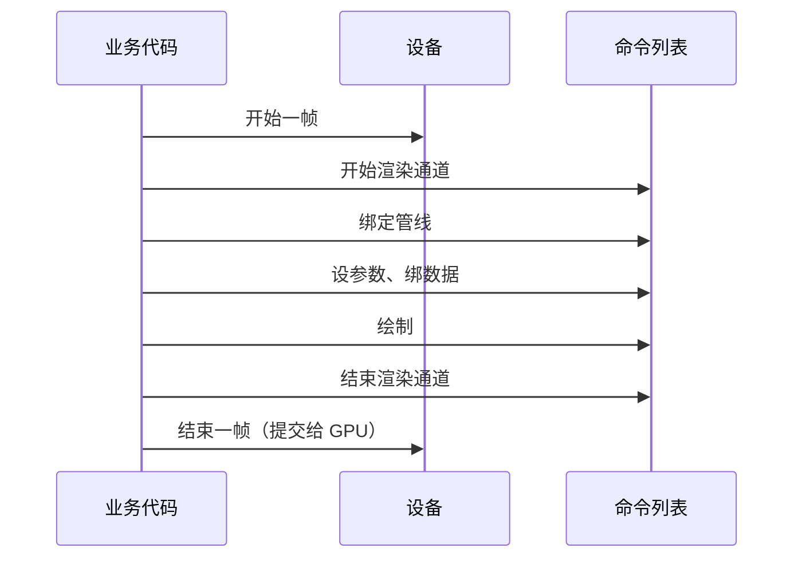
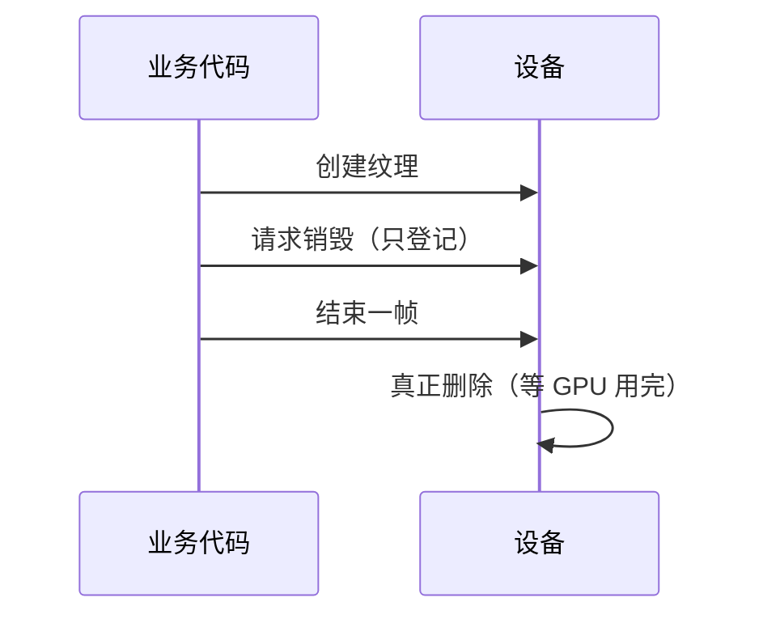
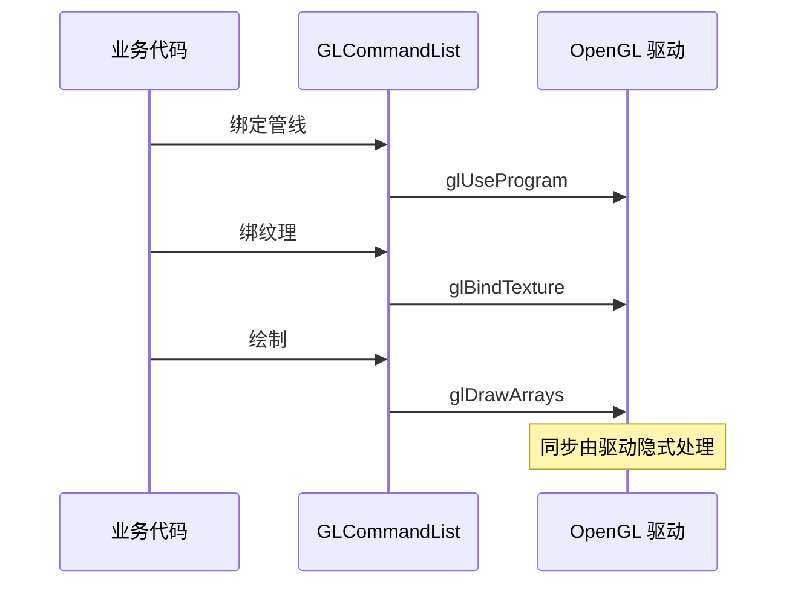
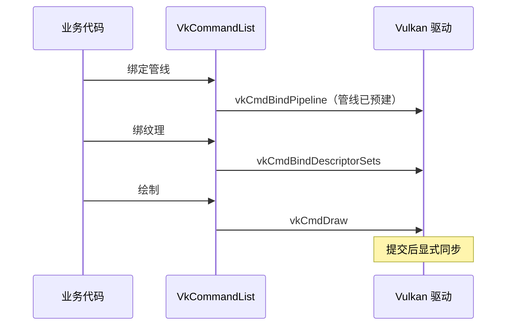
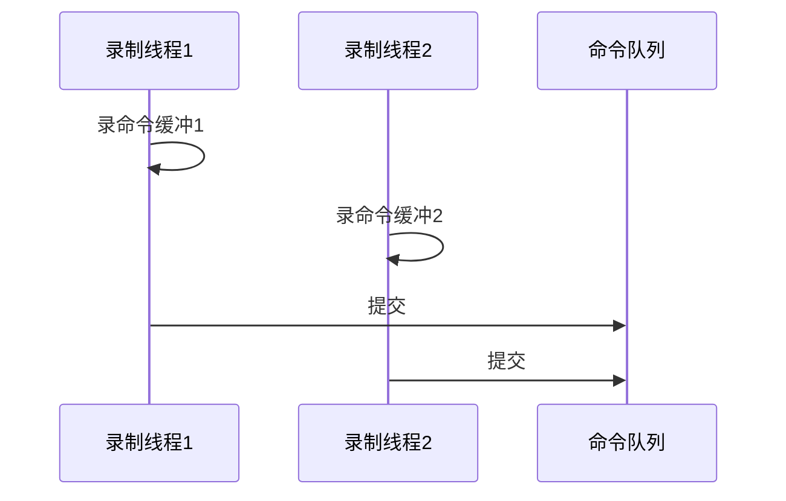

# 类设计与时序图

这份讲：代码怎么组织、运行起来怎么协作。图用 Mermaid，编辑器里自动渲染成图。

## 核心类图

说明：

- 两个接口：IRHIDevice（设备）、IRHICommandList（命令列表）。
- 每个接口两个实现：GL 的（GLDevice、GLCommandList），Vulkan 的（VulkanDevice、VkCommandList）。
- RHIFactory 是工厂，按后端创建设备；命令列表由设备每帧提供。
- 资源（缓冲、纹理、管线、采样器、离屏目标、数据块）是**句柄**，不是对象类。后端内部的数据结构（如 VkBufferRes、GLTexture）不对外暴露。

## 目标架构（v3 正在做）

下面这些现在还没有，是 RHI 重构（v3）的目标：

| 目标 | 现在 | 说明 |
|---|---|---|
| 队列 | 没有，endFrame 直接提交 | 拆出队列：提交、呈现、等待 |
| 描述符集 | bindTexture 内联处理 | 拆成描述符句柄 |
| 同步（Fence） | 内部延迟销毁队列 | 拆成显式同步对象 |
| 多线程录制 | 单线程 | 拆出命令池，支持多线程录命令 |

## 一帧怎么协作

## 资源从创建到销毁

关键点：`destroy` 不立刻删，因为 GPU 可能还在用这一帧的数据。用「句柄 + 延迟销毁」，不用引用计数或智能指针。

## 两个后端画同一个模型的对比

业务代码调用的接口完全一样，差别全在后端内部消化。这两张图并排看，就是 RHI「封装住后端差异」的直接证据。

**OpenGL 后端（隐式同步、全局状态）**

**Vulkan 后端（显式同步、预建管线）**

## 多线程录制（目标，v3）

现在是单线程。这是 v3 的目标形态，等命令池拆出来后才有：

## 维护约定

- 类图只维护核心骨架，细节靠代码注释。
- 时序图只画关键流程，不追求覆盖所有调用。
- 图用 Mermaid 写，跟代码一起版本管理。
